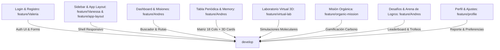

# ReactivA 🧪⚡

**ReactivA** es una plataforma educativa web interactiva, moderna y gamificada, diseñada para el aprendizaje dinámico y experimental de la química y las ciencias naturales para estudiantes de secundaria y media vocacional (grados 10° y 11°). 

Combina simuladores interactivos 3D, una matriz periódica completa con modelos atómicos cuánticos de Bohr, minijuegos de memoria y síntesis orgánica, arenas de retos competitivos y seguimiento pedagógico curricular.

---

## 📌 Estado Actual del Proyecto (¿Cómo vamos hasta ahora?)

El proyecto se desarrolla bajo una arquitectura modular y escalable con **Angular 21 (Standalone Components)**, organizando el trabajo en **ramas de características (`feature/*`)** que se integran progresivamente:



---

## 🧩 Módulos y Componentes Implementados

A continuación se detalla el estado actual de cada componente de la plataforma:

| Módulo / Componente | Ruta URL | Estado | Descripción y Funcionalidades Principales |
| :--- | :--- | :---: | :--- |
| **Inicio de Sesión (`LoginComponent`)** | `/login` | ✅ Integrado | Selector de rol (*Estudiante* y *Docente/Tutor*), formulario reactivo con validaciones en tiempo real, diseño responsivo y redirección fluida al Dashboard. |
| **Registro de Usuarios (`RegisterComponent`)** | `/register` | ✅ Integrado | Formulario de alta con validación de credenciales, roles escolares, campos adaptados y enlace directo a inicio de sesión. |
| **Navegación Lateral (`SidebarComponent`)** | Global | ✅ Integrado | Menú lateral colapsable/expandible con control de estado (`isCollapsed`), navegación activa por `routerLinkActive`, acceso rápido al *Asistente Átomo* y enlaces directos a *Settings* y *Help*. |
| **Shell & Layout (`AppComponent`)** | Global | ✅ Integrado | Contenedor dinámico que oculta automáticamente el sidebar en pantallas de autenticación (`/login`, `/register`) y provee scroll independiente y responsive en el área principal (`<main class="main-content">`). |
| **Panel Principal (`DashboardComponent`)** | `/dashboard` | ✅ Integrado | Saludo personalizado, racha activa de 5 días (🔥), banner interactivo al laboratorio 3D, **Buscador dinámico reactivo con `FormControl`**, **Lista interactiva de misiones diarias con checkboxes**, y **Barras de progreso en estilos vinculados dinámicamente (`[style.width.%]`)**. |
| **Tabla Periódica Interactiva (`PeriodicTableComponent`)** | `/periodic-table`<br>`/tabla-periodica` | ✅ Integrado | Matriz completa de 18 columnas posicionales CSS Grid, buscador reactivo por nombre/símbolo/número, leyenda de familias químicas, **Panel de Detalle Químico inferior** (con visor cuántico del **Modelo de Bohr SVG**, distribución electrónica por capas $n$, configuración electrónica en notación estándar y sub-grid 2x2 de propiedades físicas), más el minijuego integrado **Memory: Parejas Periódicas** (volteo 3D, 5 elementos por categoría, cronómetro, contador de movimientos y modal de victoria). |
| **Laboratorio Virtual 3D (`VirtualLabComponent`)** | `/virtual-lab` | ✅ Integrado | Mesa de trabajo interactiva de química virtual, simulación de enlaces moleculares, combinación de reactivos químicos, control de instrumental de laboratorio y feedback experimental. |
| **Misión Orgánica: Domina el Carbono (`MisionOrganicaComponent`)** | `/mision-organica` | ✅ Integrado | Módulo gamificado de química del carbono para grado 11: 4 niveles de progresión (*Detectives del Carbono*, *Cazadores de Hidrocarburos*, *El Desafío IUPAC*, *Maestro del Carbono*), mecánicas de match, selección múltiple, retos contrarreloj y feedback pedagógico con persistencia en `localStorage`. |
| **Desafíos & Arena de Logros (`ChallengesComponent`)** | `/challenges` | ✅ Listo | Arena competitiva escolar: cabecera de **Temporada 3: Enlaces Iónicos (En Vivo)**, widgets de nivel 14 (*Alquimista Experto* con racha de 5 días y barra de XP de 4,850/5,000) y torneo activo (*Gran Enlace Covalente*), **Grid de 4 misiones activas** con reloj de cuenta regresiva (`08:42:15`), **Leaderboard escolar** con filtros (*Mi Clase 10° B*, *Colegio*, *Top Nacional*) destacando al líder Mateo R., **Vitrina de Trofeos** con 18 insignias (7 desbloqueadas, Nivel Coleccionista II con modal pedagógico), y panel de **Seguimiento Académico y Evaluación Curricular (Estándares MEN)** con 94.2% de eficiencia pedagógica. |
| **Perfil del Estudiante (`ProfileComponent`)** | `/profile` | ✅ Integrado | Resumen de rendimiento académico, métricas de competencias científicas alcanzadas, historial de actividades recientes, datos de usuario y estadísticas globales de aprendizaje. |
| **Configuración (`SettingsComponent`)** | `/settings` | ✅ Integrado | Panel de preferencias del estudiante: ajustes de notificaciones, efectos de audio del simulador, tema de interfaz y opciones de accesibilidad. |

---

## 📂 Estructura del Código Fuente (`src/app/`)

```text
src/app/
├── app.html                  # Shell del layout principal con sidebar y router-outlet
├── app.routes.ts             # Definición y lazy loading de rutas principales
├── app.scss                  # Estilos estructurales del layout base
├── app.ts                    # Controlador raíz (AppComponent)
├── challenges/               # Componente de Desafíos & Arena de Logros
│   ├── challenges.html
│   ├── challenges.scss
│   └── challenges.ts
├── dashboard/                # Panel de control del estudiante con misiones y buscador
│   ├── dashboard.html
│   ├── dashboard.scss
│   └── dashboard.ts
├── login/                    # Autenticación y acceso
│   ├── login.html
│   ├── login.scss
│   └── login.ts
├── organic-mission/          # Módulo gamificado «Misión Orgánica: Domina el Carbono»
│   ├── organic-mission.html
│   ├── organic-mission.scss
│   └── organic-mission.ts
├── periodic-table/           # Tabla periódica interactiva (18 columnas) + Memory Game
│   ├── periodic-table.html
│   ├── periodic-table.scss
│   └── periodic-table.ts
├── profile/                  # Perfil del usuario y reporte pedagógico
│   ├── profile.html
│   ├── profile.scss
│   └── profile.ts
├── register/                 # Registro de nuevos usuarios
│   ├── register.html
│   ├── register.scss
│   └── register.ts
├── settings/                 # Ajustes y preferencias de la aplicación
│   ├── settings.html
│   ├── settings.scss
│   └── settings.ts
├── sidebar/                  # Menú de navegación lateral colapsable
│   ├── sidebar.html
│   ├── sidebar.scss
│   └── sidebar.ts
└── virtual-lab/              # Simulador de Laboratorio Virtual 3D
    ├── virtual-lab.html
    ├── virtual-lab.scss
    └── virtual-lab.ts
```

---

## 🌿 Flujo de Trabajo y Gestión en Git

El flujo oficial utiliza exactamente seis ramas: `main`, `develop`, `feature/Valeria`, `feature/Vanessa`, `feature/Andres` y `feature/app-layout`.

Cada integrante desarrolla sus componentes en su rama personal. Andrés revisa e integra los Pull Requests hacia `develop`; `main` se reserva para la entrega final autorizada. Las rutas se configuran por turnos en `feature/app-layout`, después de integrar los componentes.

Consulta [responsabilidades, validaciones y flujo de Git Graph](CONTRIBUTING.md).

---

## 🛠️ Tecnologías y Herramientas

* **Framework:** [Angular 21](https://angular.dev/) (Arquitectura 100% **Standalone Components**).
* **Gestión de Estado & Reactividad:** `ReactiveFormsModule`, `FormControl`, `valueChanges`, Observables con RxJS.
* **Detección de Cambios:** Zoneless Angular (`ChangeDetectorRef.markForCheck()`).
* **Representaciones Visuales Cuánticas:** Gráficos vectoriales SVG dinámicos para órbitas atómicas, electrones cuánticos y núcleos atómicos.
* **Animaciones 3D:** CSS 3D Transforms (`perspective`, `rotateY(180deg)`, `transform-style: preserve-3d`) para el volteo de cartas.
* **Estilos:** SCSS modular, BEM, sistema de variables corporativas, gradientes personalizados y maquetación CSS Grid / Flexbox.
* **Iconografía:** [Phosphor Icons](https://phosphoricons.com/) (`<i class="ph ph-..."></i>`).
* **Persistencia Local:** `localStorage` para almacenamiento local de progreso, vidas, insignias y configuraciones.
* **Pruebas:** Vitest (`@angular/build:unit-test`).

---

## 🚀 Guía de Inicio Rápido

### Requisitos Previos
* [Node.js](https://nodejs.org/) v24.16.0 (versión usada en las validaciones y CI).
* [Angular CLI](https://angular.dev/tools/cli) (`npm install -g @angular/cli`).

### Pasos de Instalación y Ejecución

1. **Clonar el repositorio:**
   ```bash
   git clone https://github.com/Andresittow/ReactivA.git
   cd ReactivA/ReactivA
   ```

2. **Instalar dependencias:**
   ```bash
   npm ci
   ```

3. **Iniciar el servidor local de desarrollo:**
   ```bash
   npm start
   # o bien: ng serve
   ```
   Accede a [http://localhost:4200/](http://localhost:4200/) en tu navegador.

4. **Compilar para desarrollo/verificación:**
   ```bash
   npm run build -- --configuration development
   ```

5. **Compilar para producción:**
   ```bash
   npm run build
   ```

6. **Ejecutar pruebas unitarias:**
   ```bash
   npm test -- --no-watch
   ```
