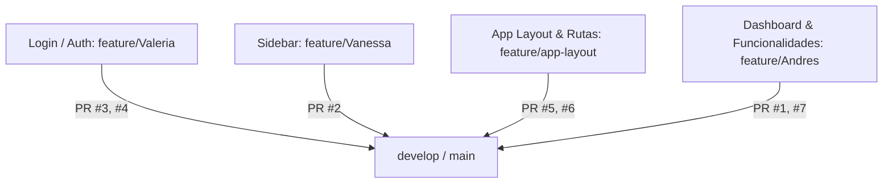

# ReactivA 🧪⚡

**ReactivA** es una plataforma educativa web interactiva y moderna diseñada para el aprendizaje y experimentación de conceptos de química y ciencias naturales a través de simuladores virtuales 3D y rutas de conocimiento guiadas.

---

## 📌 Estado Actual del Proyecto (¿Cómo vamos hasta ahora?)

Actualmente, el equipo trabaja de forma modular mediante **ramas de características (`feature/*`)** que se integran progresivamente en `develop`:



### 1. Módulos y Componentes Implementados

| Módulo / Vista | Responsable / Rama | Estado | Descripción |
| :--- | :--- | :---: | :--- |
| **Inicio de Sesión (`/login`)** | `feature/Valeria` | ✅ Integrado | Interfaz UI/UX moderna y responsiva con selector de rol (*Estudiante* y *Docente/Tutor*), formulario reactivo con validaciones y redirección al Dashboard. |
| **Navegación Lateral (`Sidebar`)** | `feature/Vanessa` | ✅ Integrado | Menú lateral con identidad de marca, navegación activa mediante `routerLink`, botones de acción rápida (*Asistente Átomo*) y accesos de pie (*Settings*, *Help*). |
| **Estructura y Layout (`App Layout`)** | `feature/app-layout` | ✅ Integrado | Contenedor principal con flexbox responsivo. Detecta automáticamente la pantalla de login para ocultar el sidebar y presenta el contenido principal con scroll independiente. |
| **Enrutamiento Base (`app.routes.ts`)** | `feature/app-layout` | ✅ Integrado | Conexión limpia y funcional de las rutas existentes (`/login` y `/dashboard`), con redirección por defecto a `/login`. |
| **Panel Principal (`/dashboard`)** | `feature/Andres` | ✅ Integrado | Vista del estudiante con saludo, racha de días activos 🔥, banner al simulador 3D (*Molecular Bonding*) y tarjetas de avance de la *Ruta del Conocimiento*. |

---

## 🌿 Flujo de Trabajo en Git

Para mantener la independencia y orden del equipo, cada miembro trabaja en su rama asignada:

* **`main` / `develop`**: Ramas estables donde se fusionan los Pull Requests aprobados.
* **`feature/Vanessa`**: Componentes estructurales y de interfaz (ej. *Sidebar*).
* **`feature/app-layout`**: Ensamblado del Layout, enrutador principal (`app.routes.ts`), estilos globales del shell y control de vistas con/sin sidebar.
* **`feature/Valeria`**: Autenticación, formularios de acceso y vistas públicas.
* **`feature/Andres`**: Dashboard principal, funcionalidades interactivas y simuladores.

---

## 🗺️ Próximos Módulos en el Roadmap

Las siguientes vistas y funcionalidades se irán incorporando en ramas dedicadas:

- [ ] **Tabla Periódica Interactiva (`/tabla-periodica`)**: Exploración detallada de elementos químicos y propiedades periódicas.
- [ ] **Laboratorio Virtual 3D (`/virtual-lab`)**: Simulador interactivo de enlaces moleculares y reacciones.
- [ ] **Desafíos y Gamificación (`/challenges`)**: Retos y cuestionarios para ganar insignias y racha.
- [ ] **Perfil y Ajustes (`/profile`, `/settings`)**: Gestión del perfil del estudiante/docente.
- [ ] **Guards de Autenticación (`AuthGuard`)**: Protección de rutas privadas para requerir inicio de sesión previo.

---

## 🛠️ Tecnologías Utilizadas

* **Framework:** [Angular](https://angular.dev/) 21 (Standalone Components).
* **SSR & Prerendering:** Angular SSR + Express.
* **Estilos:** SCSS modular con variables y diseño responsivo.
* **Iconografía:** [Phosphor Icons](https://phosphoricons.com/).
* **Pruebas Unitarias:** [Vitest](https://vitest.dev/).
* **Control de Versiones:** Git + GitHub (Flujo por Feature Branches & Pull Requests).

---

## 🚀 Guía de Inicio Rápido

### Requisitos Previos
* [Node.js](https://nodejs.org/) (versión 20 o superior).
* [Angular CLI](https://angular.dev/tools/cli) (`npm install -g @angular/cli`).

### Instalación y Ejecución

1. **Clonar el repositorio:**
   ```bash
   git clone https://github.com/Andresittow/ReactivA.git
   cd ReactivA/ReactivA
   ```

2. **Instalar dependencias:**
   ```bash
   npm install
   ```

3. **Iniciar el servidor de desarrollo:**
   ```bash
   npm start
   # o bien: ng serve
   ```
   Abre [http://localhost:4200/](http://localhost:4200/) en tu navegador.

4. **Compilar para producción:**
   ```bash
   npm run build
   ```

5. **Ejecutar pruebas unitarias:**
   ```bash
   npm test
   ```
